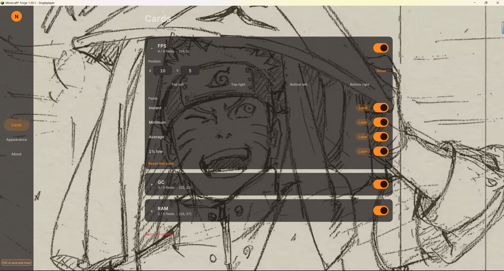
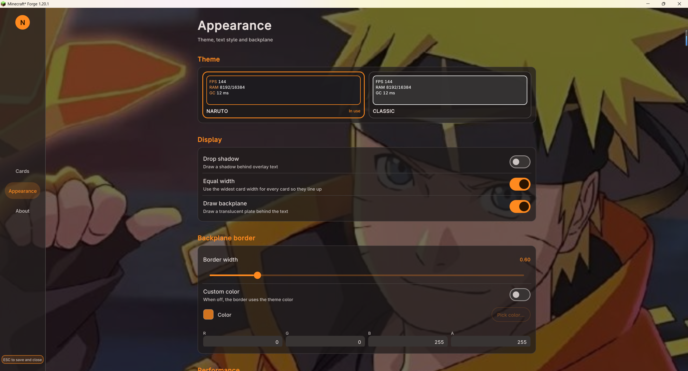
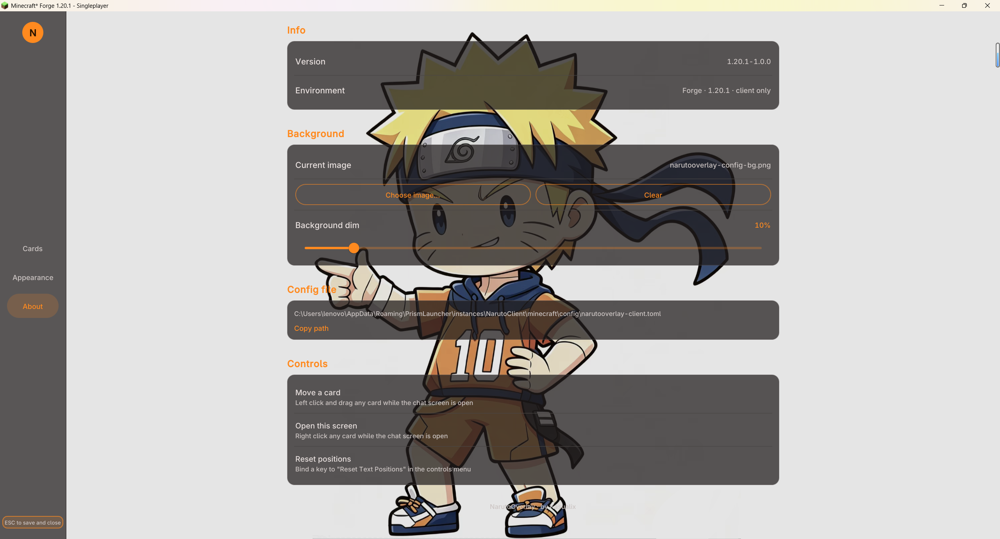
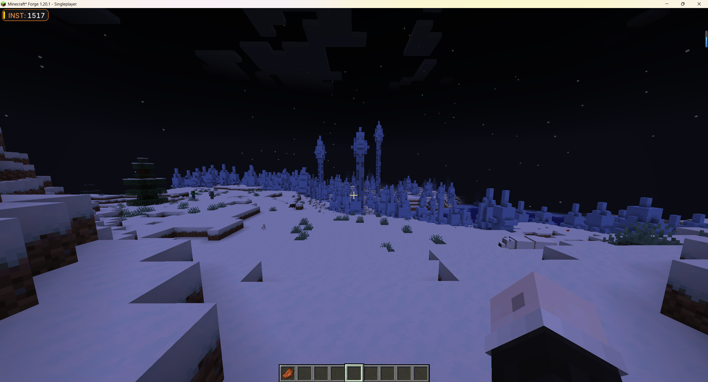
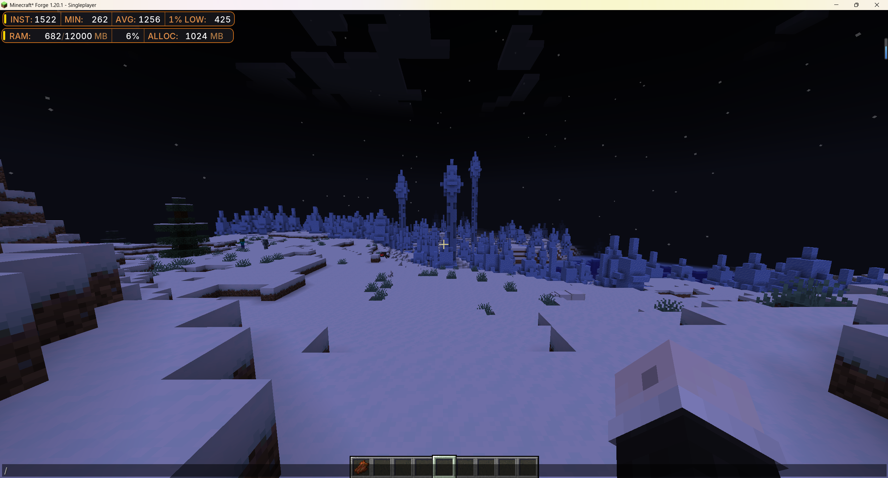
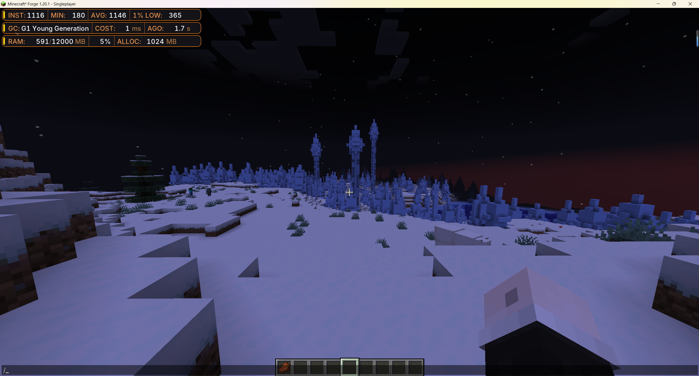

# NarutoOverlay

Keep an eye on your game without turning the HUD into a wall of numbers. **NarutoOverlay** adds a compact, live performance overlay for Minecraft, with separate cards for FPS, memory usage, and garbage collection. Show the details you care about, hide the rest, and make the overlay fit your screen and style.

## Features

- **Useful FPS stats:** check instant, minimum, average, and 1% low FPS.
- **Memory and GC details:** see RAM usage, allocation, and percentage, along with the active garbage collector, its recent cost, and when it last ran.
- **Cards you control:** enable or disable cards and choose which fields each one displays.
- **A HUD that fits your setup:** move cards to any corner, or drag them into place; optionally align card widths for a cleaner layout.
- **A custom configuration experience:** NarutoOverlay's in-game settings are built on Modern UI, with a theme-matched interface, color controls, and a customizable background image.
- **Make it yours:** choose the Naruto-inspired or Classic overlay theme and tune text, backplane, and performance update options.
- **Client-side:** install it on your client; your server does not need the mod.

For everyday use, the default HUD stays intentionally lean: it shows only **Instant FPS** with the **Naruto-themed backplane**. Average FPS, GC details, RAM information, and other display options are available to enable and customize to your preference in the configuration screen.

**Modern UI is optional** and provides NarutoOverlay's in-game configuration screen and its custom UI features. The performance overlay itself works without Modern UI; configuration values can still be adjusted in `narutooverlay-client.toml`.

## Getting started

Install the release that matches your Minecraft version and mod loader. Install **Modern UI** as well to use NarutoOverlay's in-game configuration screen. Open the in-game chat, then **right-click an overlay card** to open its settings. **Left-click and drag** a card while chat is open to move it. You can also bind **Reset Text Positions** in Controls to restore the default layout.

In the settings, the **Cards** page controls visibility, position, and displayed fields. **Appearance** lets you choose a theme and adjust the overlay's look and update intervals.

## Screenshots

The background image in Modern UI configuration screen is also customizable. We use our logo by default.

### Overlay Cards (Modern UI)

### Appearance Settings (Modern UI)

### About and Controls (Modern UI)

### FPS Details

### FPS and RAM

### Full Overlay

